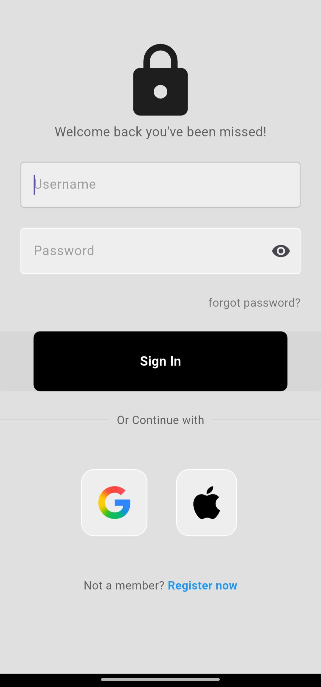

# Login UI

A clean, modern, and responsive user authentication UI built with Flutter.

## Overview

Login UI is a mobile user interface template designed for authentication flows. It features a modern design layout with custom input fields for username and password, password visibility toggling, a primary sign-in button, social authentication tiles for Google and Apple, and navigational options for password recovery and user registration.

## Preview

## Features

- Custom Username and Password text fields with form validation support
- Password visibility toggle (show/hide password)
- Primary action button for user authentication
- Social login options supporting Google and Apple icons
- Options for password recovery and account registration
- Responsive scrollable layout optimized for mobile screens
